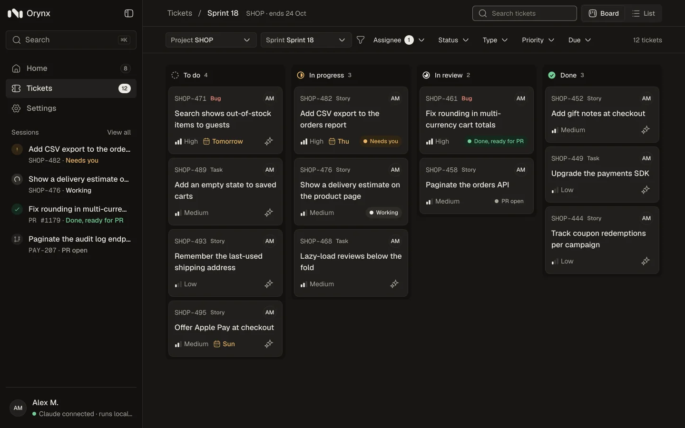
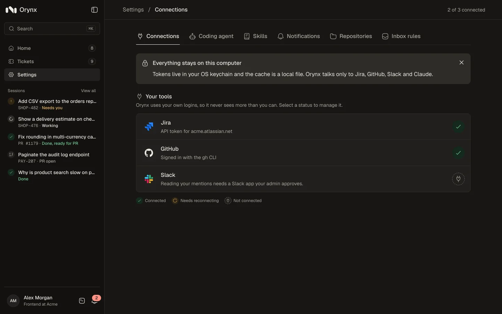

# Orynx

**Hand your agent the ticket. Keep your flow.**

Orynx is a developer-first, plug-and-play app on your laptop. Connectors bring the Jira tickets and GitHub reviews that need you into one inbox, and the coding agent you plug in, Claude today, builds a ticket in its own git worktree. You choose how far it goes: ask before every command, or push the branch and open the pull request on its own.


## What it does

### One inbox: know what needs you, and why

Orynx reads your assigned tickets, review requests and your own pull requests, then shows only what is waiting on you. Each row says why it is there and how long it has waited, so the next step is obvious.

- **Approve command**: an agent session is waiting for your click before it runs a command.
- **Review requested**: pull requests that asked for your review, longest wait first.
- **Checks failing**: your own pull requests with red checks or unresolved comments.
- **Due tomorrow**: assigned tickets by due date, with high-priority bugs on top.

### Your sprint, with your agent on the board

Board or list, filtered by assignee, status, type, priority and due date. Every card shows where its agent session stands, and any card can start one.



### Delegate the work, stay close to the change

A session takes a ticket from brief to pull request in five visible steps: plan, build, test, review and pull request. Step in at any of them, or let it run.

1. **Start from a ticket or a sentence.** Paste a Jira key, pick a ticket from the board, or describe the task. Add pull requests and files as context, then choose the repository and the model.
2. **The agent works in its own worktree.** Each session gets a fresh git worktree and branch, so your main checkout stays untouched. Watch the plan, the files the agent reads and every edit as it happens.
3. **Your settings decide what runs.** The agent does what you allowed in Settings and asks for the rest: allow once, always allow, or deny. Review the diff file by file and ask for changes without starting over.
4. **Ship your way.** The agent drafts the pull request title and description. Push and open it with one click, or allow it to push the branch and open the pull request on its own.


### Your rules: as hands-on or hands-off as you like

Pick a level in Settings › Coding agent, then set any kind of call to Allow, Ask or Block. The agent checks your settings before every call.

- **Three levels to start from.** Cautious asks before every edit and command. Balanced edits freely and runs your allowed commands. Hands-off runs, pushes and opens pull requests by itself.
- **Your own mix.** Edits, commands, the network, deleting outside the session's copy, pushing and pull requests each have their own row.
- **Pull requests without the click.** Allow push and pull request, and the agent ships the session's branch as you, never forced. Until then, it never pushes on its own.
- **Sandboxed unless you say so.** Commands run with no network and write only to the session's copy. Each risky row warns you when you allow it.
- **Stop at any moment.** Stop the agent mid-step, or discard the session and its worktree.


### Local-first: your workspace, on your machine

There is no Orynx cloud. Orynx is a small server and a web app, both on your laptop.

- **Tokens in your OS keychain.** Jira and GitHub tokens are saved in your keychain and never reach the browser.
- **Bound to 127.0.0.1.** The server listens only on this computer and checks a token on every request.
- **A local cache.** Synced tickets and pull requests live in one file on your disk.
- **Only what you connect.** Orynx talks only to the connectors and agent you plug in: Jira, GitHub and Claude today, Slack and more next.



### The details

- **Search everything with ⌘K.** Jump to any ticket, pull request or session from anywhere in the app.
- **Context in a paste.** Add tickets, pull requests and files to a brief, or paste a Jira key or GitHub link.
- **A live diff.** Every changed file and its diff, updating as the agent edits.
- **Follow-ups, not restarts.** Ask the agent to change something and it carries on in the same session.
- **Your own skills.** Save instructions you reuse, then call them with / in the composer.
- **Model and effort per task.** Pick the model and how hard it works for each task, or keep the agent's default.

Inside the repo the code name is DevHub: the `@devhub/*` packages, the `DEVHUB_*` settings, the `~/.devhub` folder and the keychain item keep that name, so saved tokens and settings carry over.

## Quick start

On macOS or Linux you need:

- Node 24 and pnpm 10
- Claude Code, signed in on this computer
- A Jira Cloud API token, and GitHub through the gh CLI or a token

```sh
nvm use            # Node 24 (see .nvmrc)
corepack enable    # pnpm 10, pinned in package.json
pnpm install
pnpm dev           # server on 127.0.0.1:4317, web app on http://localhost:4318
```

To run it the way a user does (one production build, one port):

```sh
pnpm start         # http://127.0.0.1:4317
```

Then connect Jira and GitHub in Settings, add a repository, and start your first session from Home.

## Repo map

| Path                  | What it is                                                                                                              |
| --------------------- | ----------------------------------------------------------------------------------------------------------------------- |
| `apps/web`            | Browser host: Vite, `index.html`, the web `Platform`                                                                    |
| `apps/server`         | Node host: env config, session token, serves the web app in production                                                  |
| `apps/desktop`        | Desktop host: Electron; `pnpm --filter @devhub/desktop package --dir` packs it                                          |
| `apps/landing`        | The public landing page: static Vite site; `pnpm --filter @devhub/landing dev` serves it on localhost:4319              |
| `packages/contracts`  | zod schemas for every HTTP body and server event                                                                        |
| `packages/api-client` | axios client, typed endpoints, TanStack Query options, event stream                                                     |
| `packages/ui`         | The DevHub design system: tokens, Tailwind theme, shadcn-based components, Storybook                                    |
| `packages/app`        | The product UI: shell, routes, features, zustand stores                                                                 |
| `packages/core`       | The local server's logic: Fastify routes, integrations, agent runtime, storage                                          |
| `specs/`              | One folder per feature: spec, plan, tasks                                                                               |
| `docs/`               | Product spec, roadmap, design system, screens, architecture, rules                                                      |
| `learn/`              | Explainer pages: how a request flows, local security, live updates, tokens and the keychain, connecting Jira and GitHub |
| `scripts/`            | Gates (one rule each), the gate runner, Claude hooks                                                                    |
| `.claude/`            | Agent kit: settings and hooks, skills, slash commands, helper agents                                                    |

The packages are split so the desktop app is a third host without a rewrite. See `docs/architecture.md`.

## How work gets done here

This repo is agent-first: Claude writes the code, people decide what to build and approve the result. Every rule that matters is checked by a program.

1. **A person picks the next spec** from `docs/product/roadmap.md` and runs `/spec <number>`. Claude writes `specs/<NNN-slug>/spec.md` with its assumptions, Given/When/Then acceptance criteria and open questions, then stops.
2. **A person answers the open questions.** This is the main human job: decisions, wording, design gaps.
3. **`/plan`** splits the spec into small tasks, each with the check that proves it.
4. **`/build`** does one task at a time: failing test first, then the code, then one commit. Gates and hooks catch broken rules as it goes, and their messages say how to fix them.
5. **`/review`** reads the whole branch with helper agents (code, security, design) and writes a review stamp that fits only that exact change. The pre-push gate blocks a push without it.
6. **A person reviews the PR** (summary, screenshots, CI) and merges.

People still decide what to build, answer the spec's questions, design the screens, approve user-visible wording, approve the pull request, and accept any skipped rule.

## Commands

| Command                         | What it does                                                             |
| ------------------------------- | ------------------------------------------------------------------------ |
| `pnpm dev`                      | Server and web app with hot reload                                       |
| `pnpm start`                    | Production build, served on 127.0.0.1:4317                               |
| `pnpm verify`                   | Everything a push needs: gates, typecheck, lint, tests                   |
| `pnpm test [path]`              | Vitest; pass a path to run only what you touched                         |
| `pnpm test:changed`             | Tests related to files changed since `origin/main`                       |
| `pnpm test:coverage`            | Full suite with the 90% coverage thresholds                              |
| `pnpm test:e2e`                 | Playwright against the real server and web app                           |
| `pnpm gates` / `pnpm gate <id>` | Every gate at once, or one gate                                          |
| `pnpm gates:test`               | The gates' own tests                                                     |
| `pnpm storybook`                | The design system gallery                                                |
| `pnpm agent-rules`              | Regenerate `AGENTS.md` and the Copilot and Cursor rules from `CLAUDE.md` |
| `pnpm lint` / `pnpm format`     | ESLint / Prettier                                                        |

## Troubleshooting

- **A port is taken.** Set `DEVHUB_PORT` (server) or `DEVHUB_WEB_PORT` (Vite) for one run, for example `DEVHUB_PORT=4417 pnpm dev`. Every setting is listed in `.env.example`.
- **The page says "Orynx restarted".** The server makes a new session token on every start, so reload the page.
- **`pnpm exec playwright install` fails with `UNABLE_TO_GET_ISSUER_CERT_LOCALLY`.** A proxy on your network re-signs TLS. Let Node trust the macOS keychain: `NODE_OPTIONS=--use-system-ca pnpm exec playwright install chromium`.
- **Settings says "Can't reach your-team.atlassian.net".** Check the VPN first. The terminal's warn line names the cause; `UNABLE_TO_GET_ISSUER_CERT_LOCALLY` means a proxy re-signs TLS with a root your OS doesn't trust either. See `learn/connecting-jira.md`.
- **Settings says "Orynx can't find the gh command".** Orynx looks for gh on the PATH of the terminal that started it. Run `which gh` there, or connect with a personal access token. See `learn/connecting-github.md`.
- **Trying things without touching your real data.** Point `DEVHUB_HOME` at a temporary folder: `DEVHUB_HOME=$(mktemp -d) pnpm dev`.

## Read next

- `CLAUDE.md` — the handbook every agent session starts with (rules, workflow, done checklist)
- `docs/product/spec.md` and `docs/product/roadmap.md` — what DevHub is and the build order
- `docs/design/design-system.md` and `docs/design/screens/` — how it looks
- `docs/architecture.md`, `docs/feature-layout.md`, `docs/design-map.md`, `docs/engineering-rules.md` — how the code is built
